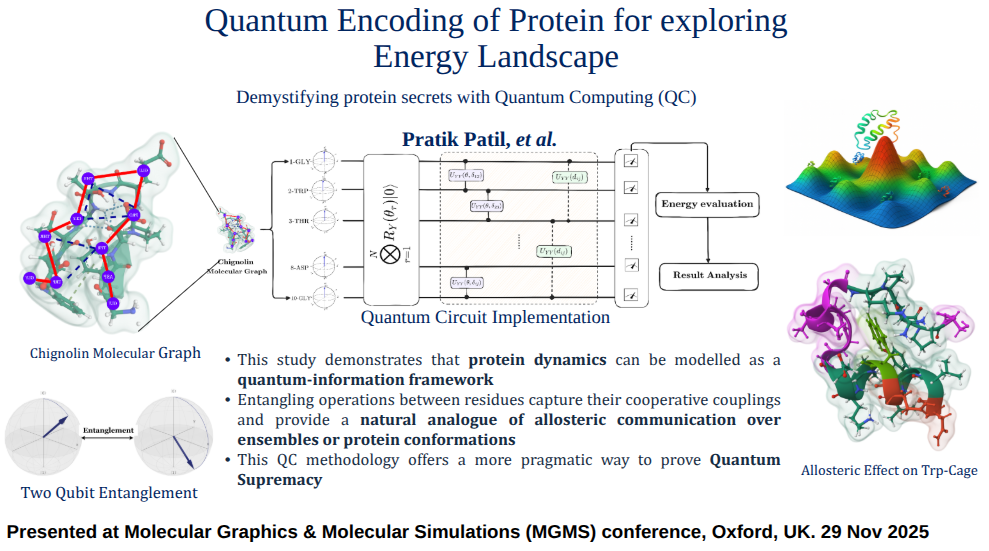

# QProtSim


Explore how residues in a protein may behave together using a simplified quantum-circuit model.

QProtSim takes a protein structure, assigns two possible model states to each amino-acid residue, and samples combinations of those states. It turns the samples into a PDF report, data tables, and figures to help you explore energy patterns and relationships between residues. You can start on a CPU; a quantum computer is not required.

**Authors:** [Pratik Patil](https://pra-ashok.github.io/CV/) · [Bhushan Bonde](https://scholar.google.com/citations?hl=en&user=O3hkOEUAAAAJ) · [Bhaskar Choubey](https://scholar.google.com/citations?user=b88L0aEAAAAJ&hl=en)

[Documentation](https://pra-ashok.github.io/QProtSim/) · [Key concepts](https://pra-ashok.github.io/QProtSim/concepts/) · [First analysis](https://pra-ashok.github.io/QProtSim/getting-started/)

[](docs/assets/branding/qprotsim-cover.png)

## What can I learn?

Use QProtSim to explore three questions:

- Which residue states are most strongly associated with changes in the model's energy distribution?
- Which residue states tend to occur together?
- Which groups of residues might be useful candidates for further study?

These results can guide research hypotheses, but a high information score alone does not establish biological communication or a mutation's effect. The model samples residue states while keeping the input coordinates fixed. Its energy values and two-state labels need to be interpreted within that model.

## Install

You need Python 3.11 or later. Download or clone this repository, open a terminal in the `QProtSim` folder, and create a separate Python environment:

```bash
python -m venv .venv
```

Activate it on macOS or Linux:

```bash
source .venv/bin/activate
```

Or in Windows PowerShell:

```powershell
.venv\Scripts\Activate.ps1
```

Then install the CPU version:

```bash
python -m pip install --upgrade pip
python -m pip install ".[cpu]"
qprotsim --help
```

If your system uses `python3` for Python 3, use it to create the environment. The [installation guide](https://pra-ashok.github.io/QProtSim/installation/) covers scientific dependencies, optional structure images, and supported GPU backends.

## Run a first analysis

Save this text as `config.yaml` in your current folder. YAML is a text format for settings; keep the layout as shown.

```yaml
pdb_code: 1L2Y
molecule_name: Trp Cage
download_dir: ./pdb_cache
chain: A
protein_only: true
shots: 10000
pl_device: default.qubit
bins: 100
output_dir: ./outputs/1l2y
report_file_name: trp_cage_report.pdf
```

This example downloads the small Trp-cage protein structure from the Protein Data Bank, selects chain A, and requests 10,000 samples. Each sample is one combination of residue states. `default.qubit` runs the circuit simulation on your CPU.

```bash
qprotsim analyze --config config.yaml
```

Open `outputs/1l2y/trp_cage_report.pdf` when the command finishes. The same folder holds CSV tables and figures. A first run needs an internet connection to download the structure. To use an existing PDB file, replace `pdb_code` and `download_dir` with `pdb_path: ./input/1L2Y.pdb`.

Use a new output folder for each run to keep earlier results. Start with a small protein: simulator memory grows rapidly with residue count. The [first-analysis guide](https://pra-ashok.github.io/QProtSim/getting-started/) explains the settings and memory requirements.

### Run with Qiskit

Install the optional Qiskit dependencies declared in `pyproject.toml`:

```bash
python -m pip install ".[qiskit]"
```

Select the framework and local Aer backend in YAML:

```yaml
backend: qiskit
qiskit_backend: aer_simulator
backend_options:
  method: statevector
  device: CPU
seed: 42
```

The ready-to-run example is `qprotsim analyze -c input/1l2y_qiskit_config.yaml`. Existing configurations use PennyLane by default. Both paths export Pauli-Z samples: `|0>` maps to `+1` (ground) and `|1>` to `-1` (excited). Qiskit's binary measurements are converted and reordered so sample columns follow residue order. The [configuration guide](https://pra-ashok.github.io/QProtSim/configuration/) explains backend settings and ket notation; the [Python guide](https://pra-ashok.github.io/QProtSim/api/) shows how to inspect the native Qiskit circuit.

## Read the results

Start with the PDF, then use the tables for closer analysis:

| Output | What it helps you understand |
| --- | --- |
| Energy plots | How the model's energy values vary across sampled states. |
| Residue statistics | Solvent exposure and how often each residue is sampled in each state. |
| Residue information scores | How a residue's state relates to the energy distribution. |
| Mutual information | Which pairs of residue states show statistical dependence. |
| Directional excitation information | How a target's state distribution changes when a source is excited. |

In the sample CSV, `+1` means the ground-like model state and `-1` means the excited model state. These labels describe solvation states in the model; they do not label a residue as folded or unfolded. See [outputs and interpretation](https://pra-ashok.github.io/QProtSim/outputs/) for filenames, units, and examples.

## Choose your next step

| Your goal | Guide |
| --- | --- |
| Learn the vocabulary and overall workflow | [Key concepts](https://pra-ashok.github.io/QProtSim/concepts/) |
| Change settings or analyse several small proteins | [Configuration](https://pra-ashok.github.io/QProtSim/configuration/) |
| Understand the assumptions and equations | [Scientific model](https://pra-ashok.github.io/QProtSim/theory/) |
| Work with results in a Python notebook or script | [Python API](https://pra-ashok.github.io/QProtSim/api/) |
| Resolve a failed run or an unclear result | [Troubleshooting](https://pra-ashok.github.io/QProtSim/troubleshooting/) |

## Citation and licence

Pratik Patil, Bhushan Bonde, and Bhaskar Choubey. *A Quantum Circuit Framework for Protein Ensemble-Level Energetics*. arXiv:2608.05491, 2026. [Read the paper](https://arxiv.org/abs/2608.05491).

For research use, cite the paper and record the QProtSim version, input structure, configuration, and chain selection. The [research page](https://pra-ashok.github.io/QProtSim/paper/) includes the citation and paper figures.

QProtSim software is distributed under the [MIT License](LICENSE). Paper figures have their own attribution and licence.
