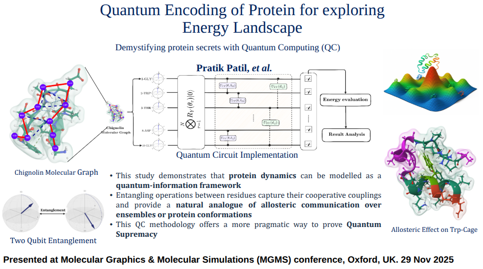
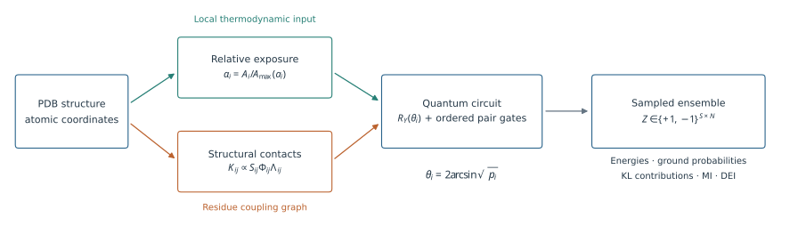

# Explore connections within a protein

QProtSim uses a simplified quantum-circuit model to explore energy patterns and relationships between amino-acid residues. Start with a protein structure and receive a PDF report, data tables, and figures. You can run the analysis on a CPU without a quantum computer.

[Run your first analysis](getting-started.md){ .button }
[Learn the key concepts](concepts.md){ .button .outline }

<figure class="qps-cover" markdown>

[{ .qps-cover-image width=989 height=551 fetchpriority=high }](assets/branding/qprotsim-cover.png)

<figcaption>Research overview by Pratik Patil et al., presented at the MGMS conference in Oxford, UK, on 29 November 2025. Reproduced unchanged. Select the image to view it at full size.</figcaption>
</figure>

**Authors:** [Pratik Patil](https://pra-ashok.github.io/CV/) · [Bhushan Bonde](https://scholar.google.com/citations?hl=en&user=O3hkOEUAAAAJ) · [Bhaskar Choubey](https://scholar.google.com/citations?user=b88L0aEAAAAJ&hl=en)

## What does QProtSim do?

A residue is an amino acid within a protein chain. QProtSim assigns each selected residue two possible model states, called ground-like and excited solvation states. Solvent exposure and residue chemistry set the starting probabilities. Structural contacts connect residues in the circuit, which is measured repeatedly to produce many combinations of states.

Those samples help you explore which residue states occur together and which residues are associated with changes in the model's energy distribution. The [key concepts guide](concepts.md) explains the vocabulary with a small example.

## Choose where to begin

| Your starting point | Suggested path |
| --- | --- |
| **New to the topic** | Read [key concepts](concepts.md), then follow [installation](installation.md) and [your first analysis](getting-started.md). |
| **Ready to use your own structure** | Follow the [configuration guide](configuration.md) and learn [how to read the outputs](outputs.md). |
| **Looking for scientific depth** | Explore the [model and equations](theory.md), assumptions, and [research paper](paper.md). |
| **Working in Python** | Use the [Python API](api.md) to run an analysis and access the samples and tables. |

## From structure to results

1. **Choose a structure.** Supply a local PDB file or a Protein Data Bank identifier and select a chain.
2. **Run the analysis.** QProtSim measures exposure, builds the residue connections, and samples the circuit.
3. **Read the report.** Start with energy plots and residue statistics, then explore the information scores.
4. **Investigate candidates.** Use the findings to plan comparisons or follow-up studies.

<figure markdown>

<figcaption>The input structure sets the model's exposure and contact information. Circuit samples provide the data used in the report.</figcaption>

</figure>

The [first-analysis guide](getting-started.md) provides a complete example using the small Trp-cage protein. Use a small structure first: simulator memory grows rapidly with the number of residues.

## What the results can tell you

QProtSim supports exploratory research into residue associations and energy patterns. Its coordinates stay fixed, while the circuit samples combinations of the two model states. The results depend on the input structure, reference energies, contact rules, and sampling settings.

A large information score can identify an interesting residue or pair for further study. Establishing physical accuracy, biological communication, or the effect of a mutation requires independent evidence. The [scientific model](theory.md#assumptions-and-interpretation) explains these limits in more detail.

## Research and attribution

**A Quantum Circuit Framework for Protein Ensemble-Level Energetics**

Pratik Patil, Bhushan Bonde, and Bhaskar Choubey. 2026. arXiv:2608.05491.

[Read the paper](https://arxiv.org/abs/2608.05491) · [Research overview and figures](paper.md) · [Download BibTeX](assets/citations/qprotsim.bib)

When using QProtSim in research, cite the paper and record the software version, input structure, chain selection, and settings. These guides describe QProtSim 0.6.1.

QProtSim software is distributed under the MIT License. Paper figures have their own attribution and licence. [Source repository](https://github.com/pra-ashok/QProtSim) · [Software licence](https://github.com/pra-ashok/QProtSim/blob/main/LICENSE)
