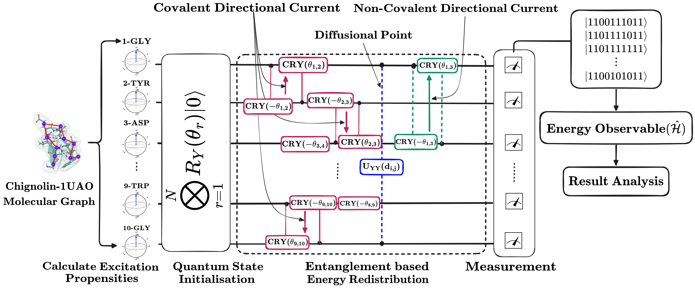
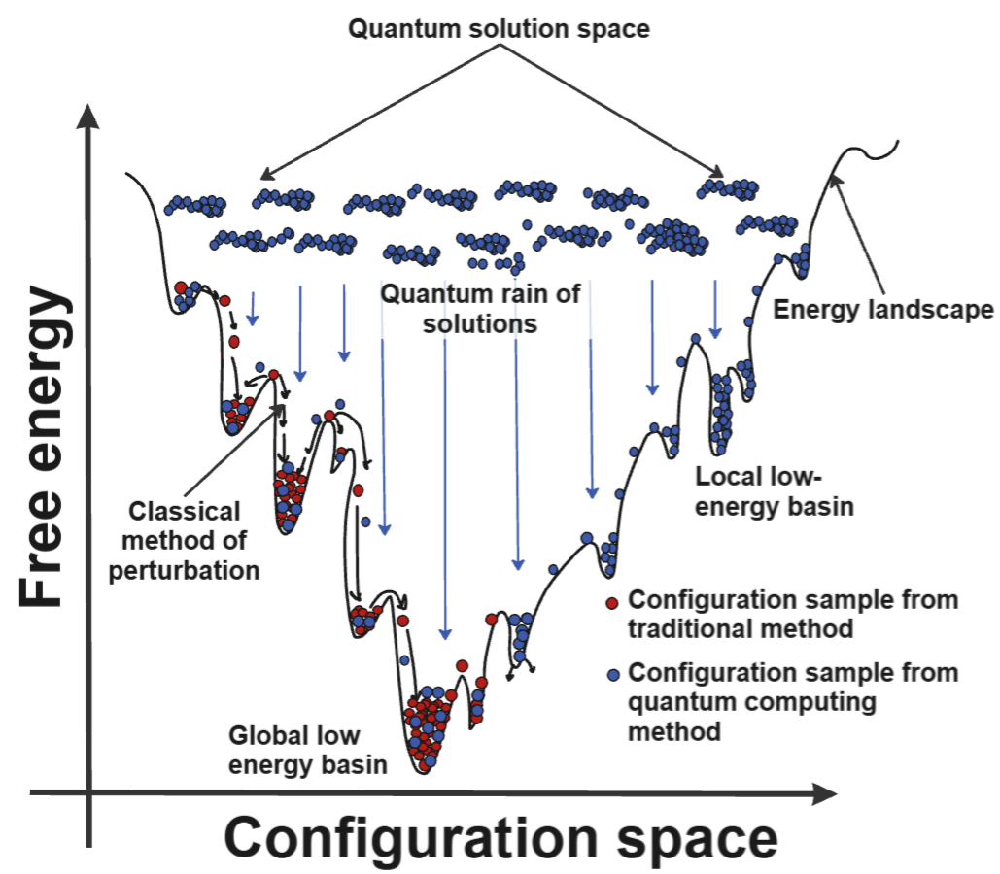
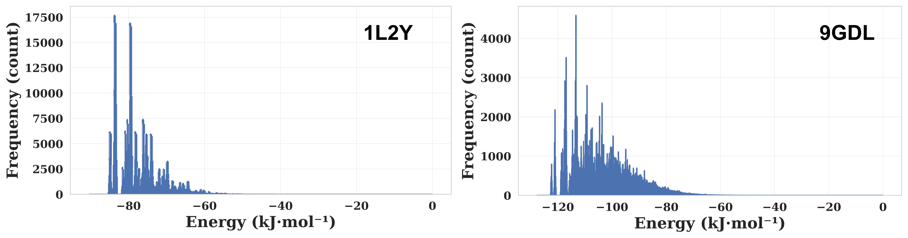

# The research behind QProtSim

## A Quantum Circuit Framework for Protein Ensemble-Level Energetics

**Authors:** [Pratik Patil](https://pra-ashok.github.io/CV/) · [Bhushan Bonde](https://scholar.google.com/citations?hl=en&user=O3hkOEUAAAAJ) · [Bhaskar Choubey](https://scholar.google.com/citations?user=b88L0aEAAAAJ&hl=en)

arXiv:2608.05491 · 2026 · Version 1, submitted 6 August 2026

[Read the paper](https://arxiv.org/abs/2608.05491){ .button }
[Explore on alphaXiv](https://www.alphaxiv.org/abs/2608.05491){ .button .outline }
[Download BibTeX](assets/citations/qprotsim.bib){ .button .outline download }

## Summary from alphaXiv

The following paraphrase condenses alphaXiv's AI overview. Its descriptions of the study should be read alongside the paper and the implementation's [mathematical definitions](theory.md).

The overview presents a way to study protein energetics by assigning one qubit to each amino-acid residue. Solvent exposure and residue chemistry set the initial probabilities of ground and excited solvation states. Gates derived from structural contacts introduce dependencies between residues, and repeated measurements produce an ensemble of binary configurations.

Those configurations support energy histograms, residue sensitivity estimates, and information measures. The overview highlights comparisons between Trp-cage 1L2Y and the disulfide-stabilised chimera 9GDL. It describes a concentrated Trp6 sensitivity signal in 1L2Y and a broader distribution of energetic influence in 9GDL. Glycine, proline, and serine regions feature in the discussion of directional residue associations.

The proposed applications include comparing mutations, investigating coupled residue groups, and generating hypotheses about allostery. [alphaXiv AI overview](https://www.alphaxiv.org/abs/2608.05491)

## Figures from the paper

The three figures below are reproduced from Pratik Patil, Bhushan Bonde, and Bhaskar Choubey, arXiv:2608.05491v1, under the publication's CC BY-NC-ND 4.0 licence. [Original paper](https://arxiv.org/html/2608.05491v1) · [Figure licence](https://creativecommons.org/licenses/by-nc-nd/4.0/)

Select a figure to open its original resolution. Source filenames and checksums are recorded with the assets. [Figure provenance](assets/paper/provenance.json)

<figure class="paper-figure" markdown>

[{ loading=lazy }](assets/paper/figure-1.png)

<figcaption>Paper Figure 2.1. Residue-to-qubit workflow, illustrated with Chignolin (1UAO). <a href="https://arxiv.org/html/2608.05491v1">Source</a></figcaption>
</figure>

<figure class="paper-figure" markdown>

[{ loading=lazy }](assets/paper/figure-2.png)

<figcaption>Paper Figure 4.2. A conceptual view of repeated circuit measurement and ensemble sampling. <a href="https://arxiv.org/html/2608.05491v1">Source</a></figcaption>
</figure>

<figure class="paper-figure" markdown>

[{ loading=lazy }](assets/paper/figure-3.png)

<figcaption>Paper Figure 3.2. Energy histograms for 1L2Y and 9GDL from one million samples each. The histograms use different bin widths. <a href="https://arxiv.org/html/2608.05491v1">Source</a></figcaption>
</figure>

The study reports energy and residue-information comparisons for 1L2Y and 9GDL using approximately one million circuit measurements. Its figures describe sampled residue states. The [theory guide](theory.md) records the equations and estimator conventions used by this version of QProtSim. [Methods and results](https://arxiv.org/html/2608.05491v1)

## Cite the paper

Pratik Patil, Bhushan Bonde, and Bhaskar Choubey. *A Quantum Circuit Framework for Protein Ensemble-Level Energetics*. arXiv:2608.05491, 2026. DOI 10.48550/arXiv.2608.05491. [Paper and citation record](https://arxiv.org/abs/2608.05491)

Include the QProtSim version or commit and the input configuration when reporting software results. [Download the BibTeX entry](assets/citations/qprotsim.bib)

## Credits

**Authors:** [Pratik Patil](https://pra-ashok.github.io/CV/) · [Bhushan Bonde](https://scholar.google.com/citations?hl=en&user=O3hkOEUAAAAJ) · [Bhaskar Choubey](https://scholar.google.com/citations?user=b88L0aEAAAAJ&hl=en)

Paper figures retain their publication attribution and licence, recorded separately from the package's MIT licence. [Publication record](https://arxiv.org/abs/2608.05491)
