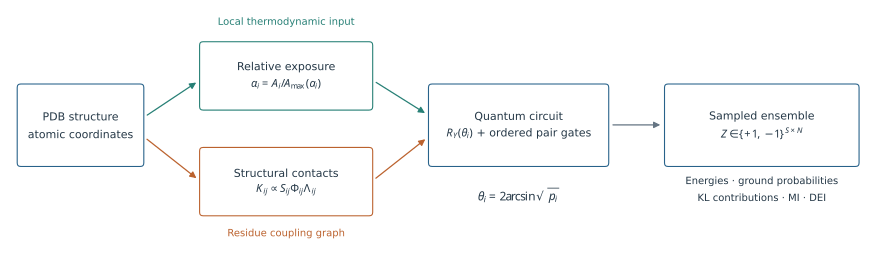
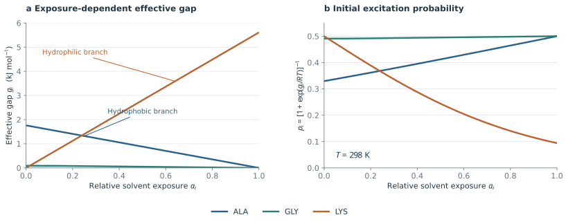
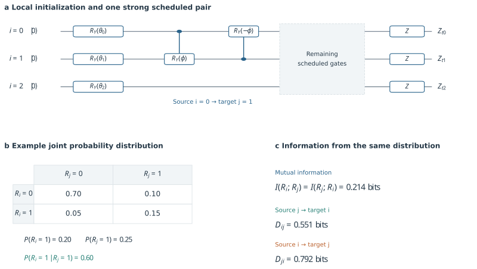

# Understanding the model

QProtSim uses a protein structure to build a simplified model of how residues may behave together. A **residue** is one amino acid within a protein. Each residue has two possible model states, and a quantum circuit creates samples of those states across the protein.

Start with the explanation below if the method is new to you. The [mathematical definitions](#mathematical-definitions) give the equations, units, and conventions needed to examine the model in detail. The [research page](paper.md) links to the accompanying paper.

## The idea in plain language

Imagine recording a row of switches, one for each selected residue. Each switch can be in a ground-like or excited solvation state. Here, **solvation** refers to the residue's interaction with its surrounding solvent. These states are simplified model labels; they do not specify new atomic coordinates.

QProtSim builds and samples this model in four steps:

1. **Measure exposure.** Estimate how much of each residue's surface is accessible to solvent.
2. **Set starting probabilities.** Combine exposure with residue chemistry and reference energies to assign each residue a starting chance of being excited.
3. **Connect residues.** Use contacts in the structure to set coupling strengths. Circuit operations then change the joint state of the residue model.
4. **Sample and compare.** Repeated circuit measurements produce an **ensemble**, or collection of sampled configurations. Energy and information measures summarize this ensemble.

One measurement is called a **shot**. A shot produces one state for every selected residue. Ten thousand shots produce ten thousand rows of states, rather than ten thousand protein structures.

<figure markdown>

<figcaption>Figure 1. Exposure sets local starting probabilities, contacts set couplings, and circuit measurements provide the samples used for analysis.</figcaption>

</figure>

## What the main results tell you

| Result | Question it helps answer | How to read it |
| --- | --- | --- |
| Ground-state probability | How often did this residue appear in the ground-like model state? | A frequency between 0 and 1, measured after the coupling circuit. |
| Energy distribution | Which model energies occur, and how spread out are they? | Each sampled configuration receives an additive residue energy. |
| Residue information gain | How much does knowing one residue's state change the energy distribution? | A relative sensitivity score within the selected residue set. |
| Mutual information (MI) | How strongly are two residue states associated? | A symmetric dependence measure in bits. |
| Directional excitation information (DEI) | How much does one residue's excitation change the state probabilities of another? | A directional conditional score in bits. |
| Motif association | Do groups of structurally connected residues show related excitation patterns? | A separate signed association score aggregated over residue groups. |

A high score identifies a feature of this model's samples. Establishing a biological role requires comparison with experiments or an independent method. See [assumptions and interpretation](#assumptions-and-interpretation) before drawing conclusions from rankings.

## Mathematical definitions

The sections below describe the default model in QProtSim 0.6.1. Each section begins with the meaning of the calculation before giving its equation.

### State convention and notation

For residue \(i\), \(|0\rangle\) represents ground-like solvation and \(|1\rangle\) represents excited solvation. Exported measurements use the Pauli-Z convention: \(+1\) means ground and \(-1\) means excited. The binary excitation indicator \(R_{ti}\) converts between these conventions:

\[
R_{ti}=\frac{1-Z_{ti}}{2},\qquad
Z_{ti}\in\{+1,-1\},\qquad R_{ti}\in\{0,1\}.
\]

Here \(t\) identifies a shot. The sample array has \(S\) rows and \(N\) columns for \(S\) shots and \(N\) selected residues. Matrix positions follow the selected residue order. CSV `res_index` values start at one and may differ from the original PDB residue numbers, which can contain gaps and insertion codes.

| Symbol | Meaning | Units |
| --- | --- | --- |
| \(\alpha_i\) | Relative solvent exposure | Dimensionless |
| \(p_i\) | Starting excitation probability | Dimensionless |
| \(\widehat p_i\) | Excitation frequency after sampling | Dimensionless |
| \(\Delta G_i=E_{1i}-E_{0i}\) | Reference energy gap | kJ mol\(^{-1}\) |
| \(K_{ij}\) | Normalized contact coupling | Dimensionless |
| \(\theta_i,\phi_\ell\) | Circuit rotation angles | Radians |

### Solvent exposure and starting probabilities

Relative exposure compares a residue's solvent-accessible surface area \(A_i\) with a reference maximum for its amino-acid type \(a_i\). A value near zero indicates little accessible surface; a value near one indicates high exposure. QProtSim uses FreeSASA and the theoretical maximum areas of Tien et al. Exposure is evaluated in the full input structure, then the requested residues are selected. [FreeSASA calculation guide](https://freesasa.github.io/python/intro.html) · [Tien et al., 2013](https://doi.org/10.1371/journal.pone.0080635)

\[
\alpha_i=\min\!\left(0.999,\frac{A_i}{A_{\max}(a_i)}\right).
\]

The default octanol reference energies use \(E_{0i}<0\) and \(E_{1i}=0\). The Kyte–Doolittle hydrophobicity value \(h_i\) determines how exposure modifies the energy gap:

\[
g_i=\begin{cases}
\Delta G_i(1-\alpha_i), & h_i>0.5,\\[2pt]
\Delta G_i[1-\max(\alpha_i,0.1)], & -0.5<h_i<0.5,\\[2pt]
\Delta G_i\alpha_i, & \text{otherwise}.
\end{cases}
\]

A two-state Boltzmann expression turns that effective gap into the starting excitation probability:

\[
p_i=\frac{1}{1+e^{g_i/(RT)}},
\qquad T=298\ \mathrm{K},\qquad
R=8.314462618\times10^{-3}\ \mathrm{kJ\,mol^{-1}\,K^{-1}}.
\]

A smaller effective gap gives a higher excitation probability. Exposure raises this probability in the hydrophobic branch and lowers it in the hydrophilic branch. The middle branch uses a minimum exposure of 0.1. With the default nonnegative gaps, \(0<p_i\leq0.5\). The YAML workflow uses the fixed temperature above.

<figure markdown>

<figcaption>Figure 2. Default starting probabilities for ALA, GLY, and LYS. Coupling operations can change the probabilities measured at the end of the circuit.</figcaption>

</figure>

### Structure-derived couplings

The coupling \(K_{ij}\) describes the model connection between residues \(i\) and \(j\). It combines structural contact scores with mass and frequency compatibility factors. It is a relative model weight, rather than a measured interaction energy.

The structural score includes backbone connectivity (BB), disulfide bonds (SS), approximate hydrogen bonding (HB), salt bridges, and heavy-atom packing (vdW):

\[
S_{ij}=1.00\kappa^{\mathrm{BB}}_{ij}
      +1.00\kappa^{\mathrm{SS}}_{ij}
      +0.50\kappa^{\mathrm{HB}}_{ij}
      +0.40\kappa^{\mathrm{salt}}_{ij}
      +0.05\kappa^{\mathrm{vdW}}_{ij}.
\]

The backbone score is one for adjacent selected residues with a backbone C–N distance at most 1.8 Å; sequence adjacency supplies a fallback when those atoms are absent. The disulfide score is one for cysteine-like SG pairs within 2.3 Å. Other scores sum nearby atom-pair contributions and bound the result between zero and one:

\[
\kappa^x_{ij}=1-e^{-u^x_{ij}},\qquad
u^x_{ij}=\frac{1}{c_x}
\sum_{(a,b)\in\mathcal C^x_{ij}}
\left(\frac{r_x}{d_{ab}}\right)^2.
\]

| Term \(x\) | Atom-pair selection \(\mathcal C^x_{ij}\) | Contact cutoff | \(r_x\) | \(c_x\) |
| --- | --- | --- | --- | --- |
| HB | N/O/S pairs | 3.5 Å | 3.5 Å | 1 |
| Salt | Oppositely charged side-chain groups | 4.0 Å | 4.0 Å | 1 |
| vdW | Heavy-atom pairs | 4.0 Å | 3.5 Å | 8 |

The hydrogen-bond score uses a distance approximation. HB and salt scores may both contribute to the same pair.

Let \(M_i\) be the residue mass and \(k_i\) its summed structural score. Relative frequency estimates \(\omega_i\) and mass compatibility \(\Lambda_{ij}\) modify the coupling:

\[
k_i=\sum_j S_{ij},\qquad
\omega_i=\sqrt{\frac{\max(k_i,10^{-12})}{\max(M_i,10^{-12})}},
\]

\[
\Phi_{ij}=\exp\!\left[-\frac{(\omega_i-\omega_j)^2}{2\sigma_\omega^2}\right],
\qquad
\Lambda_{ij}=\frac{2\sqrt{M_iM_j}}{M_i+M_j},
\]

\[
\widetilde K_{ij}=S_{ij}\Phi_{ij}\Lambda_{ij},\qquad
K_{ij}=\frac{\widetilde K_{ij}}{\max_{(a,b)}\widetilde K_{ab}}.
\]

The default \(\sigma_\omega\) is the standard deviation of the estimated frequencies, with a fallback of one. These frequencies are relative model quantities; they are not calibrated physical vibration frequencies.

### Circuit preparation and coupling operations

A **qubit** is the two-state unit used by the quantum circuit. QProtSim assigns one qubit to each selected residue. A local rotation sets its starting excitation probability:

\[
\theta_i=2\arcsin\sqrt{p_i},\qquad
R_Y(\theta_i)|0\rangle
=\sqrt{1-p_i}|0\rangle+\sqrt{p_i}|1\rangle.
\]

The starting state is \(\bigotimes_i R_Y(\theta_i)|0\rangle\). Coupling gates then act in a prescribed order, so the final residue probabilities can differ from their starting values.

The default schedule uses \(p_i\) clipped to \([\epsilon,1-\epsilon]\), where \(\epsilon=10^{-12}\), and computes a driving score \(a_{i\rightarrow j}\) and coupling-weighted schedule score \(\delta_{i\rightarrow j}\):

\[
\mu_i=\beta\Delta G_i p_i,\qquad
d_i=\sum_{k\in\mathcal N(i)}K_{ik},\qquad \beta=1.0,
\]

\[
a_{i\rightarrow j}=\max\!\left(0,
\frac{\mu_i-\mu_j}{\mu_i+\mu_j+10^{-5}}\right),
\qquad
\delta_{i\rightarrow j}=\operatorname{clip}_{[0,1]}
\left(\frac{2K_{ij}a_{i\rightarrow j}}{d_i+d_j+\epsilon}\right).
\]

Here \(\beta\) is the schedule's numerical scale; the starting Boltzmann probabilities use \(1/(RT)\). Positive schedule entries are sorted by decreasing \(\delta\). Entry \(\ell\), counting from one, receives a discounted angle:

\[
\phi_\ell=\min\!\left(\frac{\pi}{2},
2\arcsin\sqrt{\gamma^\ell\delta_\ell}\right),
\qquad\gamma=0.95.
\]

For \(a_{i\rightarrow j}>0.02\), a controlled rotation from \(i\) to \(j\) is followed by the reverse controlled rotation with angle \(-\phi\). Weaker entries use an IsingYY rotation with angle \(\min(\pi/6,2\arcsin\sqrt{a_{i\rightarrow j}})\). These are the default circuit rules. The exported `deltaP` is a schedule score; the actual change in a residue's probability depends on the complete ordered circuit.

<figure markdown>

<figcaption>Figure 3. One strong scheduled pair and a synthetic probability example. The example illustrates how conditioning can give different scores in opposite directions.</figcaption>

</figure>

### Configuration energies and state frequencies

Each shot receives the sum of the reference energies for its residue states:

\[
E_t=\sum_{i=1}^{N}
\left[(1-R_{ti})E_{0i}+R_{ti}E_{1i}\right],\qquad
\widehat p_{\mathrm{ground},i}=\frac{1}{S}\sum_t\mathbf1[Z_{ti}=+1].
\]

With the default energies, \(\sum_iE_{0i}\leq E_t\leq0\). Couplings influence which configurations are sampled through the circuit. The energy sum itself contains the residue terms shown above.

The exported `p_exc` is the starting probability \(p_i\). The exported `p_ground` is measured after coupling. The final excitation frequency is therefore `1 - p_ground`.

### Residue sensitivity from energy histograms

This score asks whether the energy distribution changes when we consider only shots in which a particular residue is ground or excited. A larger difference means that knowing the residue's state is more informative about the sampled energy.

Let \(P_b\) be the overall probability in energy bin \(b\), and let \(Q^{(s)}_{ib}=P(E\in b\mid R_i=s)\) describe the distribution for residue \(i\) in state \(s\). A Kullback–Leibler (KL) divergence measures their difference:

\[
D_i^{(s)}=\sum_b Q^{(s)}_{ib}
\ln\frac{Q^{(s)}_{ib}}{P_b},\qquad
\mathrm{KL}_{i,s}=\frac{D_i^{(s)}}{\sum_jD_j^{(s)}}.
\]

The raw divergence uses natural logarithms. The exported `KL_ground` and `KL_exc` are dimensionless scores, each normalized separately across residues. They depend on the selected residues, histogram bins, and shot count. A value of 0.2 means a one-fifth share of that column's total divergence; it does not mean a 20% probability of biological importance.

The calculation adds small positive values to the global and conditional histograms (\(10^{-12}\) and \(10^{-5}\), respectively), then normalizes them for the divergence calculation. The standard report uses 10,000 bins for this score. Its `bins` setting controls the displayed energy plots separately.

A state with no observations has no defined conditional histogram. If all raw divergences sum to zero, their relative contributions are also undefined. These cases can produce `NaN`, meaning a numerical value could not be calculated.

### Mutual information and directional excitation information

**Mutual information (MI)** measures how much knowing one residue's state tells us about another's, considering both states. It is symmetric: exchanging the residues gives the same score.

\[
I(R_i;R_j)=\sum_{a,b\in\{0,1\}}
P(R_i=a,R_j=b)\log_2
\frac{P(R_i=a,R_j=b)}{P(R_i=a)P(R_j=b)}.
\]

MI is reported in bits. The MI matrix has a zero diagonal by convention. The four joint probability matrices \(P_{00},P_{01},P_{10},P_{11}\) also have zero diagonals; their off-diagonal entries sum to one for each residue pair.

**Directional excitation information (DEI)** asks a narrower question: how much does observing the source residue in its excited state change the target residue's state distribution? **Columns are sources and rows are targets.**

\[
D_{ij}=\sum_{a\in\{0,1\}}
P(R_i=a\mid R_j=1)\log_2
\frac{P(R_i=a\mid R_j=1)}{P(R_i=a)}.
\]

DEI includes both target states and is reported in bits. It can differ between directions. A nonnegative `threshold` subtracts a noise floor and clamps the score at zero. A source with no observed excitations receives a zero column, which should be read as insufficient excitation observations. Rare source excitations can give unstable estimates even when the score is large.

At the distribution level, MI averages conditional divergences over both source states:

\[
I(R_i;R_j)=\sum_{b\in\{0,1\}}P(R_j=b)
D_{\mathrm{KL},2}\!\left(P(R_i\mid R_j=b)\,\Vert\,P(R_i)\right).
\]

DEI uses only the excited-source condition, without weighting by its frequency. This is why MI and DEI answer different questions.

### Motif association

A **motif** here is a small group of connected residues, such as a peptide pair or a three-residue group. Motif analysis aggregates residue associations to examine these groups together.

It uses a signed excitation contribution in natural-log units, called nats:

\[
B_{ij}=q_{ij}\ln\frac{q_{ij}+\epsilon}{\widehat p_i+\epsilon},
\qquad q_{ij}=P(R_i=1\mid R_j=1).
\]

Positive values indicate excitation enrichment and negative values indicate depletion relative to the target's overall excitation frequency. This signed quantity has its own meaning and units; compare it separately from MI and DEI.

The default minimum source support is 20 excited observations. Overlapping motif memberships aggregate residue scores into directional motif scores \(C_{VW}\). For clustering, a symmetric affinity uses \(|C_{VW}|+|C_{WV}|\), scales by the 95th percentile of positive values, and clips to \([0,1]\). This affinity measures relative grouping strength within the analysis.

## Assumptions and interpretation

QProtSim models residue solvation states and structural contacts from a fixed input structure. Its ensemble is defined by the circuit. The two-state Boltzmann starting probabilities do not establish that the final coupled ensemble is a calibrated equilibrium distribution.

Use the results to identify candidates for further study: residues with unusual sensitivity, associated pairs, or connected groups worth testing. MI, DEI, and motif scores describe statistical relationships in samples. Directionality in a conditional score alone does not establish a causal pathway or biological allostery.

When comparing analyses, keep the residue selection, sampling settings, and model assumptions consistent. Preserve the input structure, chain selection, configuration, software version, and relevant exported model parameters. Repeated runs help reveal variation from finite sampling; rare states may need more observations before their scores are interpretable.

One residue corresponds to one qubit. A standard state-vector simulator stores \(2^N\) complex amplitudes for \(N\) residues, so memory requirements rise rapidly with protein size. See the [first-analysis guide](getting-started.md) for practical sizing and the [output guide](outputs.md) for reading exported results.
